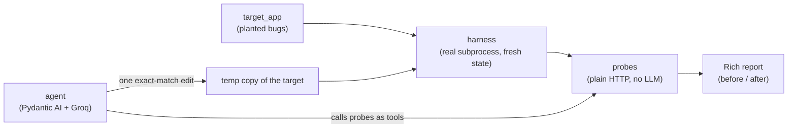
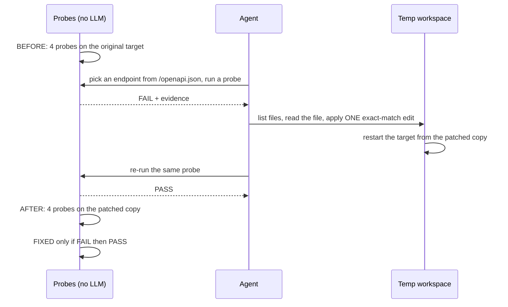

# code-breaker

**An agent that attacks your FastAPI app, writes the fix, and proves it.**

Most "AI security" tools say *"looks fixed to me."* code-breaker doesn't get to say that. Deterministic probes attack the app first. An LLM agent patches the bug in a throwaway copy. The **same probes** then run again, and the word **FIXED** is only printed by the code when a probe went from **FAIL to PASS**. The model never gets to declare victory.

```
                    before / after
┏━━━━━━━━━━━━━━━━━━━━━━━━┳━━━━━━━━━━━━━━━━━━━━━━━━━━━━━━━━━━━┳━━━━━━━━┳━━━━━━━┳━━━━━━━━━━━━━━━━━━┓
┃ Probe                  ┃ Endpoint                          ┃ Before ┃ After ┃ Outcome          ┃
┡━━━━━━━━━━━━━━━━━━━━━━━━╇━━━━━━━━━━━━━━━━━━━━━━━━━━━━━━━━━━━╇━━━━━━━━╇━━━━━━━╇━━━━━━━━━━━━━━━━━━┩
│ idor                   │ /wallets/{wallet_id}              │ FAIL   │ PASS  │ FIXED            │
│ unauthenticated_access │ /wallets/W_B/transactions         │ FAIL   │ PASS  │ FIXED            │
│ idor                   │ /wallets/{wallet_id}/transactions │ FAIL   │ PASS  │ FIXED            │
│ idempotency            │ /wallets/W_A/withdraw             │ FAIL   │ FAIL  │ STILL VULNERABLE │
└────────────────────────┴───────────────────────────────────┴────────┴───────┴──────────────────┘
FIXED = FAIL before, PASS after, against these probes only. Not a proof of security.
```

That is real output from a real run (saved in [`demo_runs/last_run.json`](demo_runs/last_run.json)). The agent fixed three bugs and honestly reported the one it did not touch.

---

## What it catches

| Bug class | What the probe does | Who fixes it |
|---|---|---|
| **IDOR** (broken object-level authorization) | Logs in as Alice, reads Bob's wallet with Alice's token. `200` means FAIL. | Agent |
| **Missing authentication** | Sends the same request with and without a token. `2xx` without a token means FAIL. | Agent |
| **IDOR on a second endpoint** | Same IDOR probe, pointed at `/transactions`. This is what catches a lazy fix (see below). | Agent |
| **Missing idempotency** | Withdraws with the same `Idempotency-Key` twice. Balance dropping twice means FAIL. | Detect only |

## How it works





1. **Harness** boots the target as a real `uvicorn` subprocess on a free port. Every run starts from fresh state.
2. **Probes** are plain `httpx` requests with an `if`. No LLM, so results are repeatable.
3. **Agent** (Pydantic AI, `groq:openai/gpt-oss-120b`) reads a compact summary of `/openapi.json`, runs probes as tools, reads the source, and writes one exact-match edit.
4. **Patch workspace** is a temp copy of the target. The edit only applies if the old text matches exactly once, the path stays inside the workspace, and the result still compiles.
5. **Report** (Rich) compares before and after. The `FIXED` label comes from code, never from the model's words.

## Run it

```bash
git clone https://github.com/ShubhamCodeWiz/codeBreaker && cd codeBreaker
uv sync

# 1) Probes only. No API key, no LLM. FAIL on the vulnerable app, PASS on the hand-patched copy.
uv run python -m code_breaker.scan --target both

# 2) The full agent loop. Needs a free Groq key.
cp .env.example .env          # then put your key in GROQ_API_KEY
uv run python -m code_breaker.run_agent --save demo_runs/last_run.json
uv run python -m code_breaker.run_agent --debug    # prints the full tool transcript

# 3) Tests (no real LLM; the model is faked with Pydantic AI's FunctionModel)
uv run pytest -q
```

`.env` is git-ignored. The model name comes from `CODE_BREAKER_MODEL` (default `groq:openai/gpt-oss-120b`).

### What happens to the patch?

The agent edits a **temp copy** in `/tmp`, verifies it there, prints the diff, and saves it in the JSON. **It does not write the fix back into your source.** `target_app/` stays vulnerable on purpose, so every run starts from the same broken app. Writing an accepted patch back is a small next step, but it is not built.

### Using it on your own app

Be honest with yourself here: **this is not plug-and-play yet.**

- The **probes** are generic. They take a `base_url`, credentials, a wallet id and a path.
- The **fixed plan** in `code_breaker/scan.py` (which probe runs where, with which users) and the **agent prompts** in `code_breaker/agent.py` are written for the wallet app. For your own FastAPI app you would change the credentials, the ids and the paths there.
- The harness expects an app importable as `module:app` that serves `/openapi.json`.

## The target: a deliberately vulnerable wallet

`target_app/main.py` is about 100 lines of FastAPI with in-memory data. The bugs are planted on purpose and marked in the code:

- `# VULN: IDOR`: any logged-in user can read any wallet.
- `# VULN: missing auth`: the transactions endpoint needs no token.
- `# VULN: no idempotency`: `Idempotency-Key` is accepted but ignored.
- The JWT secret is 16 bytes and hard-coded. PyJWT warns about it. It is intentional.

Every other check in the app is correct, so each probe isolates exactly one bug. `tests/fixtures/patched_target/` is a hand-written fixed copy, used to prove that the probes go FAIL on the original and PASS on the fix.

## Thinking process

*(These are the decisions I made and the bugs I hit while building it.)*

**Probes have no LLM.** An LLM deciding "is this vulnerable?" gives a different answer every run. A probe that sends a request and checks a status code does not. The LLM only decides *where* to point a probe and *how* to patch.

**Every probe sends a control request first.** Before attacking Bob's wallet, the probe reads Alice's own wallet. If that fails, the endpoint or login is wrong, and a `403` on the attack would look like a PASS when it is not. So the probe returns **INCONCLUSIVE** and never sends the attack. This also tells the agent when it picked the wrong user.

**Idempotency is judged by balance delta, not status code.** A secure app may replay a `200` or return a `409`. Both are fine. What matters is whether the balance dropped once or twice.

**A token is not a fix.** The missing-auth probe passes as soon as a token is required. But if the agent only adds `Depends(get_current_user)` and forgets the ownership check, Alice can still read Bob's transactions. So the same endpoint also gets the IDOR probe, and the agent has to satisfy both. This incomplete-fix case is proven in a scripted test (`FunctionModel`). It did **not** occur in my live runs, where the model got it right on the first try.

**Bugs the live model found for me:**
- With no way to list files, the model **guessed** paths (`wallets.py`, `src/api/wallets.py`). Fix: a `list_target_files` tool, and valid paths returned on a path error.
- It then looped on small failed calls. Fix: a hard request limit and a repeat-call guard that stops the run and prints the transcript.
- After a patch, `uvicorn` was still serving the old code, because the module was imported at startup. Fix: restart the target after every successful edit.

**Free tier is a real constraint.** Groq's free tier returned `429`s while the agent loop was looping. Token use per call turned out to be small. The loop was the problem, not the size of the prompts.

## Limitations (honest)

- **"FIXED" means FAIL then PASS against these probes only.** It is not a proof of security. The footer of the report says so.
- It targets **one small, planted wallet app.** I have not run it on a real codebase.
- The agent patches **IDOR and missing auth only.** Idempotency is detected and reported, not fixed. A correct fix needs design decisions (key scope, what to store).
- Probes treat `401`/`403`/`404` as PASS. A `404` hides data but does not prove authorization is right. The control request reduces this risk but does not remove it.
- The missing-auth probe reports a fact. It does not know whether an endpoint is *supposed* to be public. The agent makes that call.
- The model fixed the logic but **left stale comments and docstrings** behind. Probes test behaviour, not comments.
- The idempotency probe is sequential and changes state (it needs a fresh target). No race-condition probe and no JWT tamper probes (`alg:none`, bad signature) yet.
- Agent reliability: [TODO: N live runs, M of them ended with every attempted fix verified]. Small sample, so I will not call it reliable.
- A temp copy plus a subprocess is an **isolated test harness, not a security sandbox.** Model-written code runs on your machine.

## Roadmap

Race-condition and JWT probes. Write an accepted patch back to the source (with confirmation). Generic target config so you can point it at any app without editing code.

## Built with

Python 3.12, FastAPI, Pydantic AI, Groq (`gpt-oss-120b`, free tier), httpx, PyJWT, Rich, pytest, uv. 92 tests.

[TODO: one honest line on how it was built, e.g. which coding agent wrote the code, that I reviewed every diff before committing, and that the early sessions used Alan AI.]
