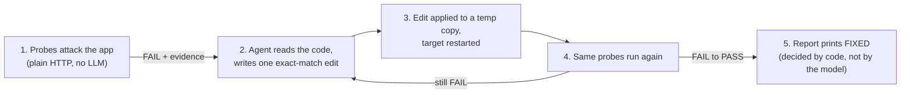

# code-breaker

**An agent that attacks your FastAPI app, writes the fix, and proves it.**

Most "AI security" tools say *"looks fixed to me."* code-breaker doesn't get to say that. Deterministic probes attack the app first. An LLM agent patches the bug in a throwaway copy. The **same probes** then run again, and the word **FIXED** is only printed by the code when a probe went from **FAIL to PASS**. The model never gets to declare victory.

```
                    before / after
┏━━━━━━━━━━━━━━━━━━━━━━━━┳━━━━━━━━━━━━━━━━━━━━━━━━━━━━━━━━━━━┳━━━━━━━━┳━━━━━━━┳━━━━━━━━━━━━━━━━━━┓
┃ Probe                  ┃ Endpoint                          ┃ Before ┃ After ┃ Outcome          ┃
┡━━━━━━━━━━━━━━━━━━━━━━━━╇━━━━━━━━━━━━━━━━━━━━━━━━━━━━━━━━━━━╇━━━━━━━━╇━━━━━━━╇━━━━━━━━━━━━━━━━━━┩
│ idor                   │ /wallets/{wallet_id}              │ FAIL   │ PASS  │ FIXED            │
│ unauthenticated_access │ /wallets/W_B/transactions         │ FAIL   │ PASS  │ FIXED            │
│ idor                   │ /wallets/{wallet_id}/transactions │ FAIL   │ PASS  │ FIXED            │
│ idempotency            │ /wallets/W_A/withdraw             │ FAIL   │ FAIL  │ STILL VULNERABLE │
└────────────────────────┴───────────────────────────────────┴────────┴───────┴──────────────────┘
FIXED = FAIL before, PASS after, against these probes only. Not a proof of security.
```

Real output from a real run, saved in [`demo_runs/last_run.json`](demo_runs/last_run.json). The agent fixed three bugs and reported the fourth as still open. After the loop fixes described below, every live run I did ended with the agent's fixes verified by the probes.

---

## What it catches

| Bug class | What the probe does | Who fixes it |
|---|---|---|
| **IDOR** (broken object-level authorization) | Logs in as Alice, reads Bob's wallet with Alice's token. `200` means FAIL. | Agent |
| **Missing authentication** | Sends the same request with and without a token. `2xx` without a token means FAIL. | Agent |
| **IDOR on a second endpoint** | Same IDOR probe on `/transactions`. This is what catches a lazy fix (see Thinking process). | Agent |
| **Missing idempotency** | Withdraws with the same `Idempotency-Key` twice. Balance dropping twice means FAIL. | Detected and reported |

## How it works



- **Harness:** boots the target as a real `uvicorn` subprocess on a free port, with fresh state every run.
- **Probes:** plain `httpx` requests and an `if`. No LLM, so results are repeatable.
- **Agent:** Pydantic AI with `groq:openai/gpt-oss-120b`. It reads a compact summary of `/openapi.json`, runs probes as tools, reads the source and writes the edit.
- **Edit guard:** the edit only applies if the old text matches exactly once, the path stays inside the workspace, and the result still compiles.

## Run it

```bash
git clone https://github.com/ShubhamCodeWiz/codeBreaker && cd codeBreaker
uv sync

# 1) Probes only. No API key, no LLM. FAIL on the vulnerable app, PASS on the hand-patched copy.
uv run python -m code_breaker.scan --target both

# 2) The full agent loop. Needs a free Groq key.
cp .env.example .env          # then put your key in GROQ_API_KEY
uv run python -m code_breaker.run_agent --save demo_runs/last_run.json
uv run python -m code_breaker.run_agent --debug    # prints the full tool transcript

# 3) Tests (no real LLM; the model is faked with Pydantic AI's FunctionModel)
uv run pytest -q
```

`.env` is git-ignored. The model name comes from `CODE_BREAKER_MODEL` (default `groq:openai/gpt-oss-120b`).

**Where does the patch go?** The agent edits a temp copy in `/tmp`, verifies it there, prints the diff and saves it in the JSON. `target_app/` stays vulnerable on purpose, so every run starts from the same broken app.

### Point it at your own app

The probes are generic: they take a `base_url`, credentials, an id and a path. The wiring for the wallet demo lives in two places:

- `code_breaker/scan.py`: which probe runs where, and with which users.
- `code_breaker/agent.py`: the agent's prompts.

Swap those for your app's users, ids and paths. The target needs to be importable as `module:app` and serve `/openapi.json`.

## The target: a deliberately vulnerable wallet

`target_app/main.py` is about 100 lines of FastAPI with in-memory data. The bugs are planted on purpose and marked in the code:

- `# VULN: IDOR`: any logged-in user can read any wallet.
- `# VULN: missing auth`: the transactions endpoint needs no token.
- `# VULN: no idempotency`: `Idempotency-Key` is accepted but ignored.
- The JWT secret is 16 bytes and hard-coded. PyJWT warns about it. Intentional.

Every other check in the app is correct, so each probe isolates exactly one bug. `tests/fixtures/patched_target/` is a hand-written fixed copy that proves the probes go FAIL on the original and PASS on the fix.

## Thinking process

**Probes have no LLM.** An LLM deciding "is this vulnerable?" gives a different answer each run. A probe that sends a request and checks a status code does not. The LLM only decides *where* to point a probe and *how* to patch.

**Every probe sends a control request first.** Before attacking Bob's wallet, the probe reads Alice's own. If that fails, the endpoint or login is wrong, and a `403` on the attack would look like a PASS when it is not. So the probe returns **INCONCLUSIVE** and never sends the attack. This also tells the agent when it picked the wrong user.

**Idempotency is judged by balance delta, not status code.** A secure app may replay a `200` or return a `409`. Both are fine. What matters is whether the balance dropped once or twice.

**A token is not a fix.** The missing-auth probe passes as soon as a token is required. But if the agent only adds `Depends(get_current_user)` and forgets the ownership check, Alice can still read Bob's transactions. So the same endpoint also gets the IDOR probe, and the agent has to satisfy both. A scripted test covers exactly this lazy fix: one probe passes, the other fails, and the agent has to try again.

**Bugs the live model found for me:**
- With no way to list files, the model **guessed** paths (`wallets.py`, `src/api/wallets.py`). Fix: a `list_target_files` tool, and valid paths returned on a path error.
- It then looped on small failed calls. Fix: a hard request limit and a repeat-call guard that stops the run and prints the transcript.
- After a patch, `uvicorn` still served the old code because the module is imported at startup. Fix: restart the target after every successful edit.

**Free tier is a real constraint.** Groq's free tier returned `429`s while the agent was looping. Token use per call was small. The loop was the problem, not the prompt size.

## Scope and limits

- **"FIXED" means FAIL then PASS against these probes.** It is evidence, not a proof of security, and the report footer says so.
- The agent patches **IDOR and missing auth**. Idempotency is detected and reported; a correct fix needs design decisions. The agent fixes the logic and does not always update the comments next to it.
- Probes cover three bug classes. `401`/`403`/`404` count as PASS, the idempotency probe is sequential, and there are no race-condition or JWT-tampering probes yet.
- A temp copy plus a subprocess is an **isolated test harness, not a security sandbox**: model-written code runs on your machine.

**Next:** race and JWT probes, writing an accepted patch back to the source with confirmation, and a config file so any app can be targeted without editing code.

## Built with

Python 3.12, FastAPI, Pydantic AI, Groq (`gpt-oss-120b`, free tier), httpx, PyJWT, Rich, pytest, uv. 92 tests. Built in 27 hours with Alan AI as the coding agent, working from written specs; I read each diff and ran the tests locally before merging.
